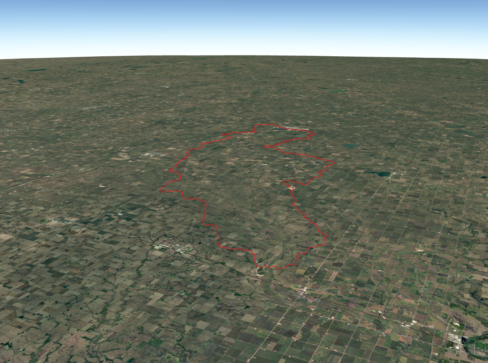
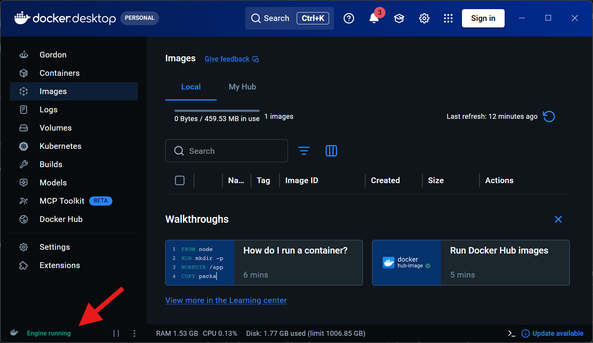
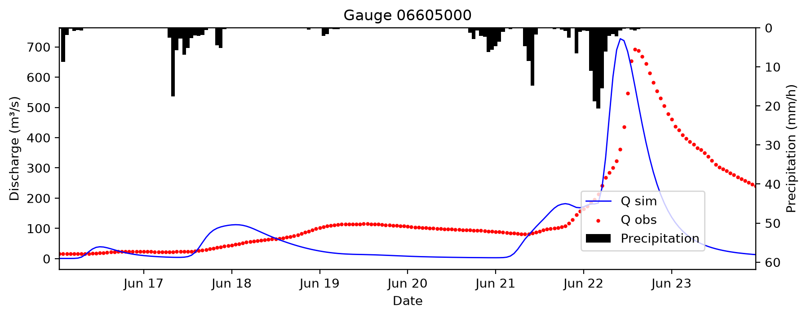
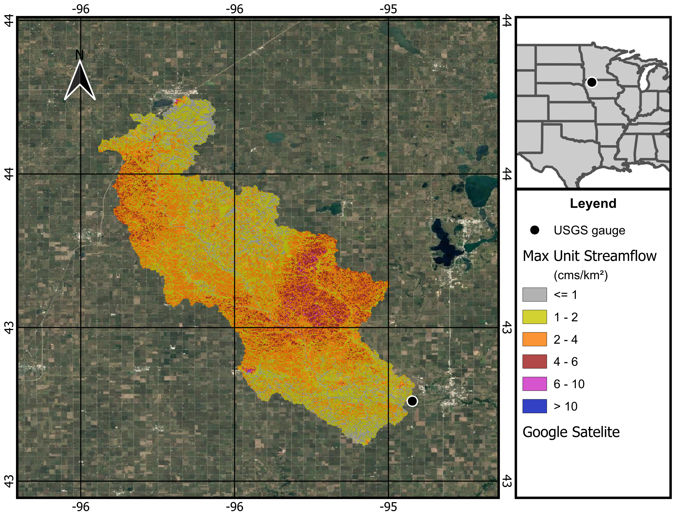

# EF5 Event Simulation Workshop, Little Sioux River, June 2024

This repository contains everything you need to run a flood event simulation with **EF5**[^1] (Ensemble Framework For Flash Flood Forecasting) using the **CREST**[^2] water balance model and **kinematic wave (KW)**[^3] routing, for USGS gauge **06605000** in the Little Sioux River basin (Iowa).

The workshop has the following steps:

0. **Install Docker Desktop** (before the workshop).
1. **Install the EF5 Docker image and download the data.** No compiling is needed.
2. **Generate the model parameters** with the Jupyter notebooks in `PARAMETER_GENERATION/`.
3. **Run the event simulation** in `EF5_EVENT_MODEL/`, which already includes all the computed parameters.

> Step 3 does **not** depend on Step 2. If you are short on time, you can go directly from Step 1 to Step 3.

 Little Sioux River basin at Smithland.


---

## Requirements

| Software | Needed for | Source |
|---|---|---|
| **Docker Desktop** | Steps 1 and 3 | https://www.docker.com/products/docker-desktop/ |
| **Python 3.10 or newer** | Step 2 | Recommended: Google Colab. Alternative: Jupyter (for example Anaconda or Miniconda) |
| **QGIS** | Optional, for visualizing the outputs | https://qgis.org/ |
---

## Download the data

Docker container & model files: [HYDROSHARE](https://www.hydroshare.org/resource/bcef1eec8edf4620a4c07103f7971424/)

Docker container: [OneDrive](https://iowa-my.sharepoint.com/:u:/g/personal/henaogomez_uiowa_edu/IQDKkPISGJB6R47jmfKj5UC5AZ3F6ZW9ZJRnVcqgA7D9maM?e=JQkNZY)

Model files: current repository.

---

## Step 0. Install Docker Desktop (before the workshop)

👉 Before the workshop, install Docker Desktop and open it once so that it finishes its setup. On Windows it may ask you to enable WSL 2 and to restart the computer.

1. **Download** Docker Desktop from the official website: [https://www.docker.com/products/docker-desktop/](https://www.docker.com/products/docker-desktop/)
2. **Install** Docker Desktop on your computer.
3. **Open** Docker Desktop and wait until it shows *Engine running*.

> **Tip:** avoid spaces and accented characters in the folder where you place this repository (for example, use `C:\EF5_Workshop`). Paths with spaces need extra quoting in Docker commands.

---

## Step 1. Install the EF5 Docker image and download the data

### 1.1 👉 Install the EF5 image in Docker

The EF5 image is distributed as a single file, `ef5-container.tar` (about 110 MB).

1. **Download** `ef5-container.tar`: [download link](https://iowa-my.sharepoint.com/:u:/g/personal/henaogomez_uiowa_edu/IQDKkPISGJB6R47jmfKj5UC5AZ3F6ZW9ZJRnVcqgA7D9maM?e=JQkNZY).
2. **Open Docker Desktop** and wait until it shows *Engine running*.

 Engine running screenshot.

3. **Load the image.** Open a terminal (PowerShell on Windows, Terminal on macOS or Linux) in the folder where you saved the file:

   ```powershell
   docker load -i ef5-container.tar
   ```

   You should see: `Loaded image: ef5-container:latest`

4. **Check** that it is installed:

   ```powershell
   docker images ef5-container
   ```

Once the image is loaded, you can delete the `.tar` file.

> **Apple Silicon Macs (M1 to M4) and ARM Windows laptops:** the image is built for Intel and AMD processors. It still works through emulation, a little more slowly. You may see a warning such as `The requested image's platform (linux/amd64) does not match the detected host platform`; it is harmless. Adding `--platform linux/amd64` to `docker run` (as in the commands below) silences it.

### 1.2 👉 Get the domain data

#### Option A. Download the ZIP file

1. **Download** the `module-2-ef5` branch of the workshop repository as a ZIP file: [direct download link](https://github.com/AHWALab/Water-Science-Exchange-Workshop/archive/refs/heads/module-2-ef5.zip).
2. **Extract** the ZIP file to a folder on your computer (see the tip above about spaces in the path).

#### Option B. Clone from GitHub

1. **Clone** the `module-2-ef5` branch of the workshop repository:
   ```bash
   git clone -b module-2-ef5 https://github.com/AHWALab/Water-Science-Exchange-Workshop.git
   ```
2. **Navigate** to the workshop directory:
   ```bash
   cd Water-Science-Exchange-Workshop
   ```

---

## Step 2. Generate the model parameters

EF5 needs gridded parameters for the water balance model (CREST) and for the routing (KW). This step shows how they are derived from soil and basin data. Ready-made results already exist in `EF5_EVENT_MODEL/parameters/`.

### 2.1 👉 Set up Google Colab

1. Open [Google Colab](https://colab.research.google.com/).
2. Click **File**, then **Upload notebook**, and select the notebook you want to run (for example, `4_Crest_parameters_estimation.ipynb` or `KW_PINN_Predict.ipynb`).
3. Click **Runtime**, then **Run all**, to execute the entire notebook.

### 2.2 CREST parameters, notebook 👉🐍 `PARAMETER_GENERATION/4_Crest_parameters_estimation.ipynb`

This notebook is part of the EF5 parameter generation workflow in the [EF5-builder-toolkit repository](https://github.com/AHWALab/EF5-builder-toolkit). It computes the CREST soil parameters from SoilGrids sand and clay content (7 depths) and depth to bedrock:

| Output (in `parameters/`) | Parameter |
|---|---|
| `crest_Wm.tif` | Maximum soil water capacity (Wm) |
| `crest_b.tif` | Infiltration curve exponent (b) |
| `crest_Fc_Ksat.tif` | Soil saturated hydraulic conductivity (Fc / Ksat) |

Notes:
- **Skip the Google Colab cell** (`from google.colab import files`) when you run the notebook on your own computer.
- If the `parameters/` folder does not exist, create it before saving the outputs.

### 2.3 KW routing parameters, notebook 👉🐍 `PARAMETER_GENERATION/KW_PINN_Predict.ipynb`

This notebook predicts the kinematic wave rating curve parameters **α (alpha)** and **β (beta)** with a pre-trained physics-informed neural network (KW-PINN, CONUS model v1.10). It uses the basin descriptors in `predictors/` (drainage area, relief ratio, mean annual precipitation and temperature, aridity index, Manning's n). Predictions are made only on channel cells (`FAM > 50`).

| Output (in `parameters/`) | Parameter |
|---|---|
| `KW_alpha.tif` | Channel α |
| `KW_beta.tif` | Channel β |

Run all cells from top to bottom. No GPU is needed.

---

## Step 3. Run the event simulation

### 3.1 About the simulation

The control file `EF5_EVENT_MODEL/outputs_event/Control_file.txt` defines:

| Setting | Value |
|---|---|
| Model and routing | CREST with kinematic wave routing |
| Gauge | USGS 06605000 (latitude 43.1304, longitude -95.2113), basin area of about 1,064 km² |
| Precipitation | MRMS Pass 2 gauge corrected QPE, hourly[^4] |
| PET | ERA5 adjusted monthly climatology |
| Period | 2024-06-16 00:00 to 2024-06-24 00:00 (hourly time step) |
| Initial states | `states/` (warm start at 2024-06-16 00:00) |

All paths in the control file are **relative to the `EF5_EVENT_MODEL` folder**, so the model must be run from there.

### 3.2 👉 Run EF5

Open a terminal **inside the `EF5_EVENT_MODEL` folder** and run:

**Windows (PowerShell)**

```powershell
cd EF5_EVENT_MODEL
docker run -it --rm --platform linux/amd64 `
  -v "${PWD}:/work" -w /work `
  ef5-container /ef5/bin/ef5 outputs_event/Control_file.txt
```

**macOS or Linux (Terminal)**

```bash
cd EF5_EVENT_MODEL
docker run -it --rm --platform linux/amd64 \
  -v "$(pwd):/work" -w /work \
  ef5-container /ef5/bin/ef5 outputs_event/Control_file.txt
```

What the options do:

| Option | Meaning |
|---|---|
| `-v "${PWD}:/work"` | Makes your `EF5_EVENT_MODEL` folder visible inside the container as `/work` |
| `-w /work` | Runs EF5 from that folder, so that the relative paths in the control file work |
| `--rm` | Deletes the container when it finishes (your results are kept) |
| `--platform linux/amd64` | Avoids the platform warning on ARM computers |

The run takes less than a minute on a typical laptop. To stop it early, press **Ctrl + C**. If that does not work, open another terminal and run `docker ps`, then `docker stop <CONTAINER_ID>`.

### 3.3 Outputs

Results are written to `EF5_EVENT_MODEL/outputs_event/`:

| File | Content |
|---|---|
| `ts.06605000.crest.csv` | Simulated and observed discharge time series at the gauge |
| `maxq.YYYYMMDD.HHMMSS.tif` | Maximum streamflow during the event (m³/s) |
| `maxunitq.YYYYMMDD.HHMMSS.tif` | Maximum unit streamflow (m³/s/km²) |
| `qpeaccum.YYYYMMDD.HHMMSS.tif` | Accumulated precipitation over the event (mm) |
| `results.json` | Run summary (run time, missing precipitation files) |

#### 3.3.1 Plot the results

Plot the `.csv` file to compare the simulated and observed hydrographs with the notebook 👉🐍 `EF5_EVENT_MODEL/Plot_results.ipynb`.

Optional: open the `.tif` grids in QGIS or in Python (`rasterio`).

 Simulated and observed hydrographs at USGS gauge 06605000 (Little Sioux River at Smithland, IA).

 Maximum Unit Streamflow.

---

## Troubleshooting

| Problem | Solution |
|---|---|
| `docker: command not found` or `not recognized` | Docker Desktop is not installed or not running. Open it, then restart your terminal. |
| `Cannot connect to the Docker daemon` | Docker Desktop is still starting. Wait until it shows *Engine running*. |
| `Failed to open configuration file /conf/control.txt` | The control file path was not passed. Use the full command in Step 3.2, including `/ef5/bin/ef5 outputs_event/Control_file.txt`. |
| EF5 cannot find the DEM, precipitation or parameter files | You are not inside `EF5_EVENT_MODEL`, or `-w /work` is missing. Paths in the control file are relative to that folder. |
| A folder named like a file (for example `my_control.txt/`) appears | Docker creates an empty folder when the file in a `-v` option does not exist. Delete it and check the path. |
| `ModuleNotFoundError` in a notebook | Install the missing package in your environment (Step 2.1) and make sure that the notebook kernel uses that environment. |
| `ModuleNotFoundError: google.colab` | Skip that cell; it is only for Google Colab. |

---

## Credits
Santiago Henao-Gomez, University of Iowa, santiago-henaogomez@uiowa.edu.

Humberto Vergara, University of Iowa, humberto-vergaraarrieta@uiowa.edu.

Mohamed Abdelkader, University of Iowa, mohamed-abdelkader@uiowa.edu.

Vanessa Robledo, University of Iowa, vanessa-robledodelgado@uiowa.edu.

Meet the research team: [AHWA Lab](https://ahwa.lab.uiowa.edu/)

[^1]: Flamig, Z. L., Vergara, H., & Gourley, J. J. (2020). The Ensemble Framework For Flash Flood Forecasting (EF5) v1.2: description and case study. Geosci. Model Dev., 13(10), 4943 to 4958. https://doi.org/10.5194/gmd-13-4943-2020

[^2]: Wang, J., Hong, Y., Li, L., Gourley, J. J., Khan, S. I., Yilmaz, K. K., Adler, R. F., Policelli, F. S., Habib, S., Irwin, D., Limaye, A. S., Korme, T., & Okello, L. (2011). The coupled routing and excess storage (CREST) distributed hydrological model. Hydrological Sciences Journal, 56(1), 84 to 98. https://doi.org/10.1080/02626667.2010.543087

[^3]: Vergara, H., Kirstetter, P.-E., Gourley, J. J., Flamig, Z. L., Hong, Y., Arthur, A., & Kolar, R. (2016). Estimating a-priori kinematic wave model parameters based on regionalization for flash flood forecasting in the Conterminous United States. Journal of Hydrology, 541, 421 to 433. https://doi.org/10.1016/j.jhydrol.2016.06.011

[^4]: Zhang, J., Howard, K., Langston, C., Kaney, B., Qi, Y., Tang, L., Grams, H., Wang, Y., Cocks, S., Martinaitis, S., Arthur, A., Cooper, K., Brogden, J., & Kitzmiller, D. (2016). Multi-Radar Multi-Sensor (MRMS) Quantitative Precipitation Estimation: Initial Operating Capabilities. Bulletin of the American Meteorological Society, 97(4), 621 to 638. https://doi.org/10.1175/BAMS-D-14-00174.1
